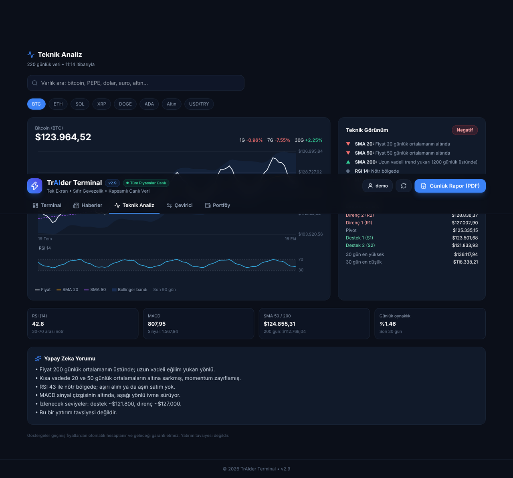
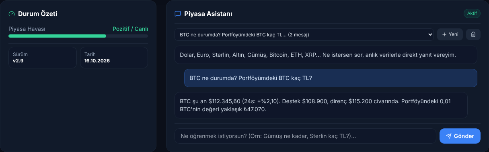
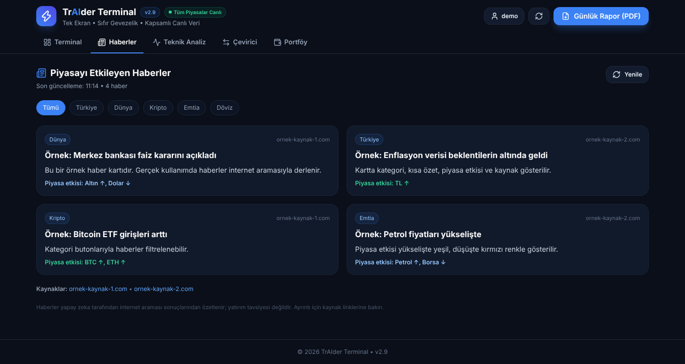
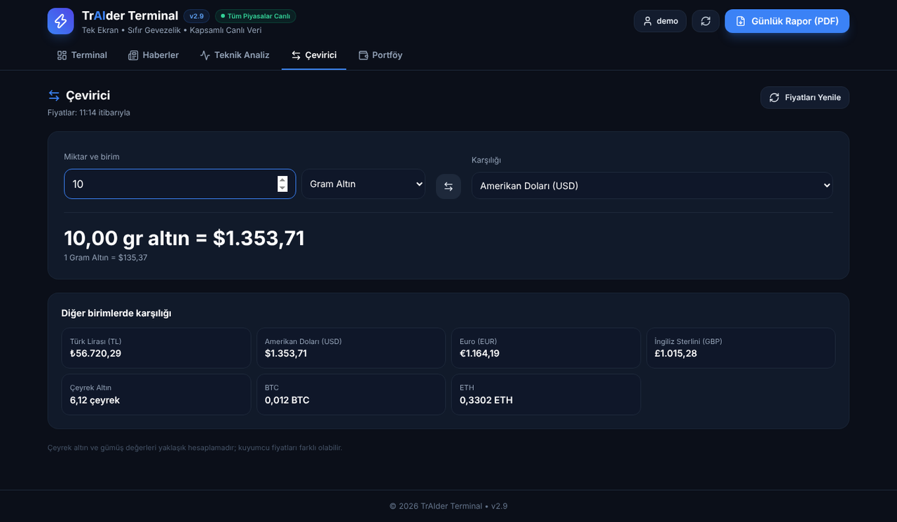
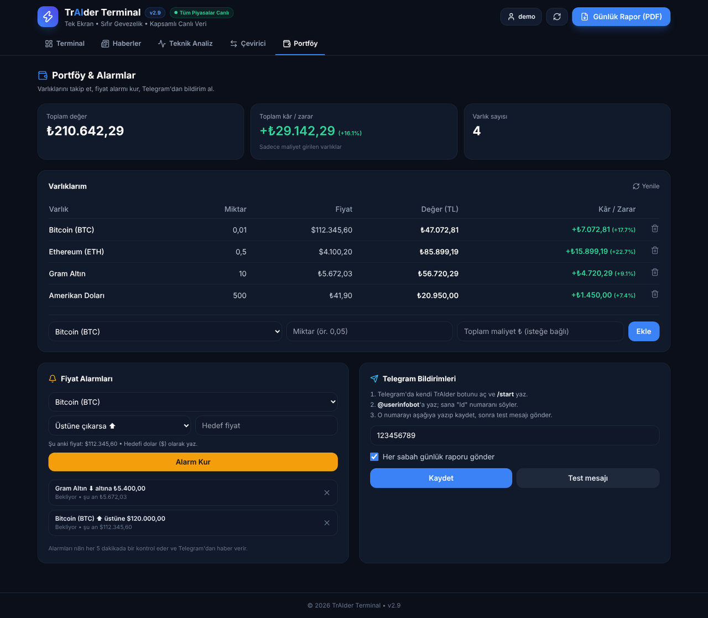
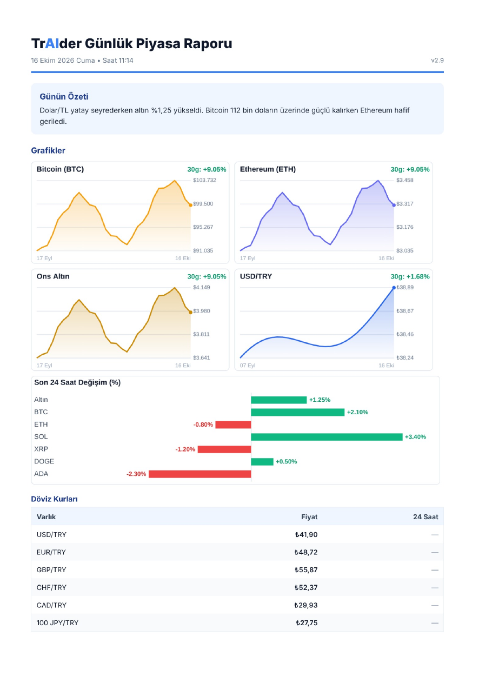

# ⚡ TrAIder Terminal

Tr**AI**der Terminal; finansal piyasalardaki karmaşık verileri, yapay zeka ve canlı grafik entegrasyonuyla tek ekranda, yalın ve net bir şekilde sunan modern bir finansal analiz platformudur.
Evet çok iyi çalışıyor!!
     



---

## 🚀 Özellikler

* **📊 Canlı TradingView Entegrasyonu:** BIST, Kripto, Emtia ve Dünya Borsaları için gelişmiş, gerçek zamanlı fiyat grafiği.
* **🤖 Yapay Zeka Destekli Piyasa Asistanı:** Gemini API ile entegre çalışan, uzatmadan net, doğrudan destek/direnç ve yön tahmini sunan sohbet terminali.
* **📰 Haberler Sekmesi:** İnternette aranan günün piyasa haberleri; kategori filtreleri ve kaynak linkleriyle.
* **📈 Teknik Analiz Sekmesi:** BTC, ETH, SOL, XRP, DOGE, ADA, Altın ve USD/TRY için RSI, MACD, hareketli ortalamalar, Bollinger bantları, pivot destek/direnç ve yapay zeka yorumu.
* **🔁 Çevirici Sekmesi:** TL, döviz, gram/çeyrek altın ve kripto paralar arasında anlık çeviri.
* **💼 Portföy & Alarmlar:** Hesap aç, varlıklarını ve kâr/zararını takip et, fiyat alarmı kur.
* **🧠 Sohbet Hafızası:** Giriş yapınca sohbetler PostgreSQL'de saklanır; uzun sohbetler özetlenerek asistanın bağlamı korunur.
* **⚙️ n8n Otomasyonları:** Saatlik fiyat kaydı, 5 dakikada bir alarm kontrolü ve her sabah Telegram'dan günlük rapor.
* **🎯 Tek Ekran & Sıfır Karmaşa:** Tüm analizi ve sorularınızı sayfalar arasında kaybolmadan tek bir arayüzden yönetme imkanı.
* **📄 Günlük Piyasa Raporu (PDF):** Giriş yapılmışsa Telegram'a da gönderilir; her sabah 09:00'da n8n grafikli PDF raporu otomatik yollar. Tek tıkla günün döviz, altın ve kripto fiyatlarını, Google'da aranan piyasayı etkileyen haberleri ve yapay zeka özetini içeren PDF rapor.
* **🌙 Dark Mode & Modern Arayüz:** Tailwind CSS ve cam efekti (*glassmorphism*) kullanılarak tasarlanmış göz yormayan, premium karanlık tema.

---

## 📸 Ekran Görüntüleri

> Görüntüler örnek verilerle alınmıştır.

### 🤖 Piyasa Asistanı
Canlı fiyatlarla cevap verir; giriş yapınca sohbetler kaydedilir ve portföyünü bilir.



### 📈 Teknik Analiz
Arama çubuğuyla yüzlerce kripto, döviz ve altın; RSI, MACD, SMA, Bollinger, destek/direnç ve yapay zeka yorumu (görsel en üstte).

### 📰 Haberler
İnternette aranan günün piyasa haberleri; kategori filtresi, piyasa etkisi ve kaynak linkleri.



### 🔁 Çevirici
TL, döviz, gram/çeyrek altın ve kripto arasında anlık çeviri.



### 💼 Portföy & Alarmlar
Varlık takibi, kâr/zarar, fiyat alarmları ve Telegram bildirim ayarları.



### 📄 Günlük PDF Rapor
Grafikler, 24 saatlik değişimler, fiyat tabloları ve yapay zeka özeti. İndirilir, Telegram'a da gönderilir.



---

## 🛠️ Teknolojiler

* **HTML5 & JavaScript (ES6+):** Temel yapı ve dinamik mantık.
* **[Tailwind CSS](https://tailwindcss.com/):** Stil ve responsive (mobil uyumlu) tasarım.
* **[TradingView Widget](https://www.tradingview.com/):** Gelişmiş canlı grafik altyapısı.
* **[OpenRouter](https://openrouter.ai/) / [Google Gemini API](https://ai.google.dev/):** Yapay zeka analiz motoru (key `.env`'de, tarayıcıya gitmez).
* **Node.js (`server.js`):** API anahtarını saklayan, piyasa verilerini çeken ve yapay zekaya bağlanan sunucu.
* **[PostgreSQL](https://www.postgresql.org/):** Kullanıcılar, portföy, alarmlar, fiyat geçmişi ve sohbet hafızası.
* **[n8n](https://n8n.io/):** Saatlik fiyat kaydı, alarm kontrolü ve sabah raporu otomasyonları.
* **[pdfkit](https://pdfkit.org/):** Sunucu tarafında grafikli PDF rapor.
* **[Lucide Icons](https://lucide.dev/):** Modern vektörel ikon seti.
* **[html2pdf.js](https://ereyes.github.io/html2pdf.js/):** Ekran görünümünü PDF belgesine dönüştürme kütüphanesi.

---

## 📦 Kurulum ve Çalıştırma

> 🗄️ **Veritabanı ve n8n kurulumu** için adım adım rehber: [KURULUM.md](KURULUM.md). Kısaca: Docker Desktop'ı kur, `.env` dosyasını doldur, `baslat.bat`'a çift tıkla, sonra `n8n-yukle.bat`'ı çalıştır.


1. **Depoyu klonlayın:**
   ```bash
   git clone https://github.com/yusufturudu/TrAIder.git
   cd TrAIder
   ```
2. **`.env` dosyasını oluşturun:** `.env.example` dosyasını kopyalayıp adını `.env` yapın ve API anahtarınızı yazın. (`.env` GitHub'a gönderilmez.)
3. **Docker Desktop'ı açın** ve **`baslat.bat`**'a çift tıklayın (veritabanı + n8n + sunucu). Kapatmak için **`durdur.bat`**.
4. Tarayıcıda **http://localhost:3000** adresini açın.

> ⚠️ **Not:** API anahtarı tarayıcıya hiç gönderilmez; `server.js` okur ve yapay zekaya kendisi istek atar. Sayfayı çift tıklayarak değil, sunucu üzerinden açın.

---

## 💡 Kullanım

1. **Sorunuzu Yazın:** Arayüzün sağ alt kısmındaki "Piyasa Asistanı" kutusuna merak ettiğiniz varlığı sorun *(Örn: "Altın ne olur?", "THYAO destek direnç neresi?", "Bitcoin kaç oldu?")*.
2. **Grafiği İnceleyin:** Üst kısımdaki TradingView aracı üzerinden canlı mum hareketlerini ve hacimleri takip edin.
3. **Rapor Alın:** Sağ üst köşedeki **Günlük Rapor (PDF)** butonuna basın; fiyatlar, haberler ve özet PDF olarak iner.

---

## 📝 Lisans

Bu proje [MIT Lisansı](LICENSE) ile lisanslanmıştır. Dilediğiniz gibi geliştirebilir ve kullanabilirsiniz.

- [İsmail Kırgın](https://www.linkedin.com/in/ismail-k%C4%B1rg%C4%B1n-752655341/)
- [Yusuf Türüdü](https://www.linkedin.com/in/yusuf-turudu/)
- [Erdem Aydın](https://www.linkedin.com/in/erdem-aydin-05b372390/)

